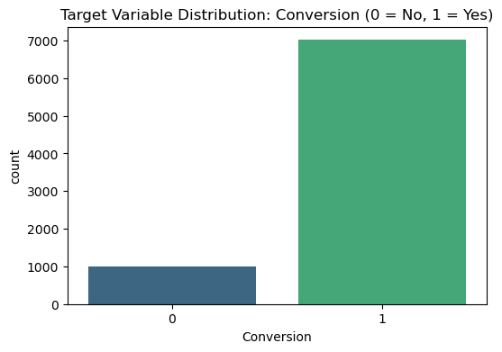

# Predicting marketing conversion, and reading the result against an 88% baseline

Random Forest, Logistic Regression and a Decision Tree trained to predict whether a customer converts, on 8,000 records from a digital marketing dataset. The Random Forest posts 89.3% accuracy and 99.4% recall, which looks excellent until you notice that 87.65% of customers in this dataset convert: a model that says "yes" to everyone gets 87.65% accuracy, 100% recall and an F1 of 93.4. The honest reading is that the models add about a point and a half over doing nothing, and that the interesting customers are the 12% who do not convert.



## Problem and data

- **Kaggle: Predict Conversion in Digital Marketing** ([rabieelkharoua](https://www.kaggle.com/datasets/rabieelkharoua/predict-conversion-in-digital-marketing-dataset)), 8,000 customers, 20 columns, no missing values. Demographics, campaign channel and type, ad spend, click-through and conversion rates, site engagement, email opens and clicks, previous purchases, loyalty points. Target `Conversion`, 7,012 positives out of 8,000. The 1.3 MB CSV is committed in `data/`.
- Strongest single correlations with conversion are weak: `TimeOnSite` 0.13, `EmailClicks` 0.13, `AdSpend` 0.12. No multicollinearity in the heatmap.

## Approach

1. Drop `CustomerID`; audit with `df.info()` and `df.describe()`.
2. One-hot encode five categorical columns with `drop_first=True` (19 → 21 features).
3. 80/20 split (6,400 / 1,600, `random_state=42`), `StandardScaler` fit on the training set.
4. Train and score `RandomForestClassifier`, `LogisticRegression` and `DecisionTreeClassifier` with accuracy, precision, recall and F1 (positive class = converted).

## Results

| Model | Accuracy | Precision | Recall | F1 |
|---|---|---|---|---|
| **Always predict "converts"** (baseline) | **87.65%** | 87.65% | 100% | 93.4% |
| Random Forest | 89.31% | 89.61% | 99.36% | 94.23% |
| Logistic Regression | 88.75% | 89.70% | 98.51% | 93.90% |
| Decision Tree | 83.44% | 91.43% | 89.54% | 90.48% |

Read against the first row: the Random Forest improves accuracy by 1.7 points and F1 by 0.8; the Decision Tree is *below* the baseline on accuracy and F1. On the positive class, the metrics are dominated by the base rate, so they say little about whether the model has learned anything about who does not convert.

## What I learned

- **Symptom:** 99.36% recall looked like a triumph. **Cause:** with 87.65% positives, recall on the positive class is nearly free; "predict yes" already gets 100%. **Fix:** always compute the trivial baseline first and put it in the results table. **Takeaway:** a metric is only as informative as the gap to the dumbest model that achieves it.
- **The class that matters is the minority.** For a marketing team, the actionable question is who will *not* convert without intervention. That means reporting precision and recall for class 0, or flipping the positive label, and the original write-up did neither.
- **Weak correlations do not add up to a strong model by themselves.** The top single-feature correlations were 0.12 to 0.13. The ensemble combines them, but the 1.7-point gain over the baseline says the combined signal in these features is modest too.
- **Accuracy was the wrong headline, again.** This dataset and the loan-default one taught the same lesson from opposite directions: there the majority class was the negative (75% paid), here it is the positive (88% convert). In both, the baseline decides what counts as good.
- **Encoding mechanics:** `drop_first=True` avoids perfectly collinear dummy columns, which matters for Logistic Regression even though trees do not care.

## What I'd do next

- Report class-0 precision and recall, a confusion matrix, and ROC-AUC and PR-AUC, which are not inflated by the base rate.
- Tune the decision threshold for the business cost: a wasted retention offer vs a lost conversion.
- Check whether `ConversionRate` (a per-customer rate column in the raw data) leaks the target, since it is suspiciously close in meaning to `Conversion`.
- Stratified cross-validation instead of a single split, given how close the models sit to the baseline.

## Run it

```
pip install -r requirements.txt
jupyter lab notebooks/marketing_conversion_prediction.ipynb
```

## Context

Week 3 homework for AIT 506 (Machine Learning), Westcliff University, summer 2026.
